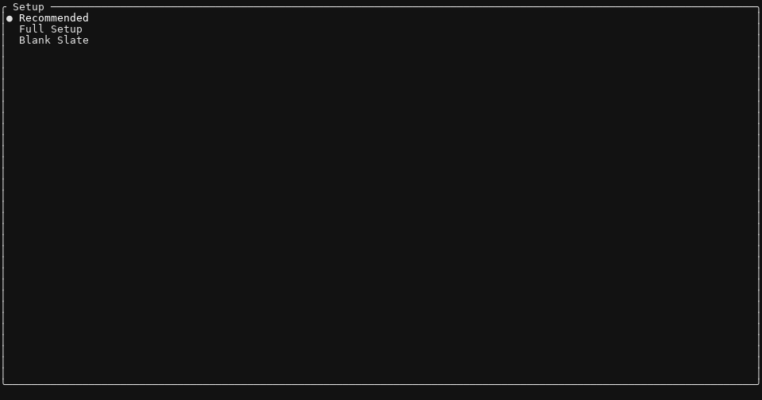
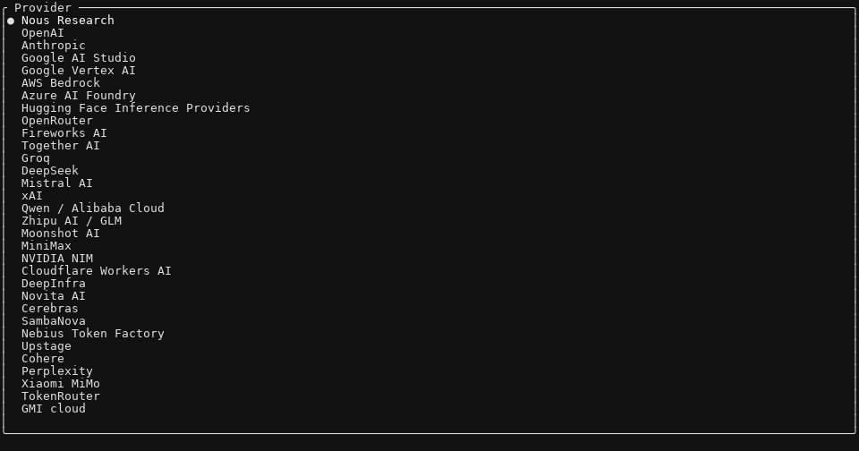
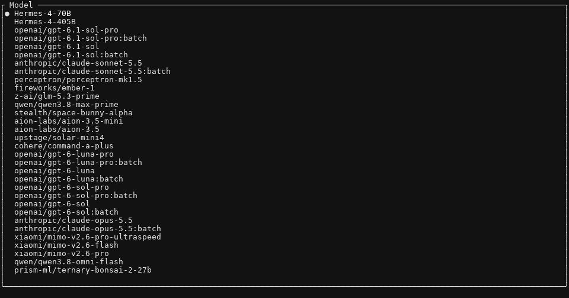
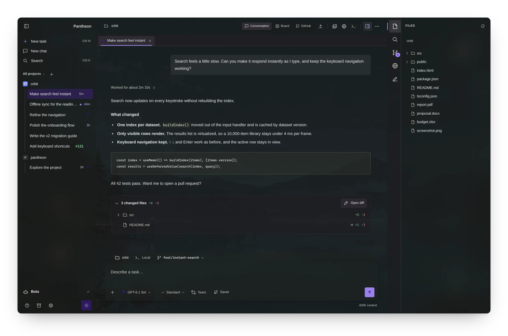
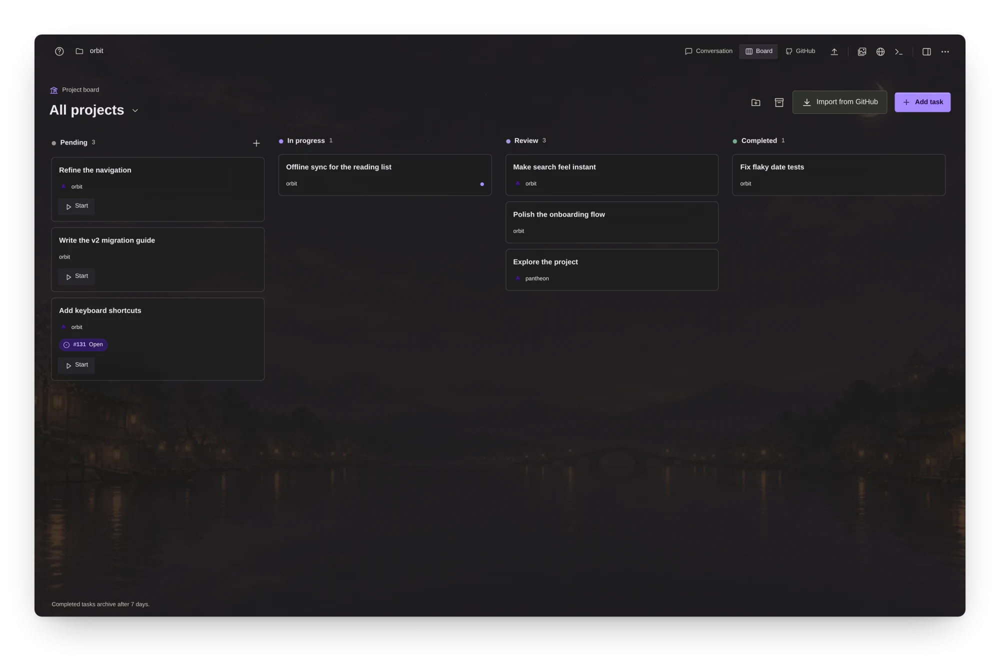
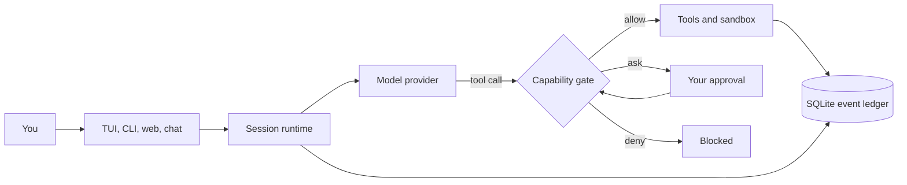

# Pantheon

<p align="center">
  <strong>Your AI. Your way of working.</strong><br>
  <em>An open, general-purpose AI agent harness.</em>
</p>

<p align="center">
  <a href="https://github.com/k1ng0mar/pantheon/actions/workflows/ci.yml"></a>
  
  
</p>

Pantheon turns a model you choose into an agent you control. Connect a provider, give the agent tools, and put it to work on your own machine. It handles sessions, memory, permissions and recovery. You decide what the agent does and what it can touch.

No cloud account. No server to keep alive. One binary and a config file in your home directory.

## Inside the app

The terminal app is a full screen interface, not a chat box in a shell. Pick a provider, pick a model, get to work.

| [](docs/feature-shots/tui-setup-chooser-20260930a.png) | [](docs/feature-shots/tui-provider-picker-20260930a.png) | [](docs/feature-shots/tui-model-picker-20260930a.png) |
|:---:|:---:|:---:|
| Setup chooser | Provider picker | Model picker |

Pantheon Desktop puts the same agent in a workspace with a task board, a file view and a diff review.

| [](desktop/docs/screenshots/conversation.webp) | [](desktop/docs/screenshots/board.webp) |
|:---:|:---:|
| Desktop conversation | Task board |

## Who it is for

Pantheon is not only a coding tool. Four groups tend to recognize themselves in it:

| You want to | What that looks like |
| --- | --- |
| Get everyday work off your plate | Organize information, research a topic, handle repetitive tasks, keep track of what you asked for last week |
| Run a small business or a team | Automate admin work, process documents, keep recurring jobs on schedule, connect the tools you already use |
| Build software | Debug, review changes, manage a repository, run tests, work across several models without rebuilding your setup |
| Build something specialized | Gather sources, run scheduled research, add plugins and skills, shape an agent around a workflow nobody else has |

The common thread is simple. You have work you want done, and you would rather do it with an agent than build an agent framework first.

## What you get

| | |
| --- | --- |
| **Your model, your terms** | Use OpenAI, Anthropic, Gemini or a custom endpoint. Switch providers without rebuilding the agent around one vendor. |
| **Ready in a few commands** | Install, answer a few setup questions, start talking. You do not need to understand tool call protocols or orchestration to begin. |
| **One agent, many kinds of work** | Coding is a capability here, not the identity. The same agent can research, write, schedule and operate tools. |
| **Permissions you can see** | Allow, deny or ask for every capability. Approvals pause a run and can be granted from the terminal, the web UI or a chat gateway. |

Pantheon also grows with you. Plugins, skills, MCP servers, memory backends and Discord or Telegram gateways all plug into the same runtime. What the agent can actually do depends on the model you connect, the tools you grant and the permissions you set. It does not promise to do everything.

## Start using it

Linux or macOS:

```sh
curl -fsSL https://raw.githubusercontent.com/k1ng0mar/pantheon/master/install.sh | bash
```

Windows (PowerShell):

```powershell
iwr https://raw.githubusercontent.com/k1ng0mar/pantheon/master/install.ps1 -useb | iex
```

Then set up a provider and open the terminal app:

```sh
pantheon setup
pantheon
```

`setup` asks which provider and model to use, where your API key lives and how strict permissions should be. The config file names the environment variable holding the key. The key itself never lands in config.

Type `/help` inside the app. For scripts, run one task and exit:

```sh
pantheon run --taskID t1 --say "summarize these logs" --deliver session
```

`pantheon doctor` checks the config, the key, storage and memory, then tells you how to fix what is wrong. Build from source with `cargo build --release` if you prefer. Rust is the only dependency.

## How it behaves

**Sessions survive restarts.** Every turn, tool call and approval is appended to a SQLite event ledger in your data dir. Close the app, reopen it, and the run picks up from the ledger rather than from a hoped-for transcript. Ledger writes are redacted as they land, so pasted secrets do not stay in the history.

**The model never sets policy.** Tools declare the capability they need. The runtime decides whether to allow it, deny it or pause for a human. A clever prompt cannot talk its way past the gate, because the gate is not in the prompt.

**Memory carries its origin.** Records keep a trust tier and a source. Outside material is clamped down to Untrusted, and writes are scanned for secret patterns. Memory informs the agent without granting it authority.

**Isolation is honest about its limits.** On Linux, shell calls request a bubblewrap user namespace with capabilities dropped, no access to your credential files and no network unless the call asks for it. If that boundary cannot be created, the call fails unless you explicitly opt into a direct spawn. macOS and Windows have no boundary backend today, so treat shell access there as unsandboxed and keep approvals on. `pantheon doctor` tells you which case you are in.

**Scheduled work is durable.** Cron, one-shot and interval jobs claim their ticks through a table that survives restarts, so a job does not fire twice because the process came back.

## Under the hood

Pantheon is a Rust workspace that ships as one binary. The runtime owns the session lifecycle, approvals, recovery and event ledger. Providers are replaceable. Tools, memory, plugins and the TUI sit at the edges. The architecture doc explains the crate boundaries and the decisions behind them: [docs/developer/architecture.md](docs/developer/architecture.md).



Pantheon Desktop lives in [desktop/](desktop/README.md) as a first-party client.

## Documentation

| Page | What it covers |
| --- | --- |
| [Getting started](docs/getting-started.md) | Install, configure, first session, platform notes |
| [Sessions](docs/user-guide/sessions.md) | The terminal app, past conversations, one-off tasks |
| [Agents](docs/user-guide/agents.md) | Named agents, profiles, working together |
| [Memory](docs/user-guide/memory.md) | What is remembered and how trust is applied |
| [Runs](docs/user-guide/runs.md) | Lifecycle, approvals, recovery, pipelines |
| [Providers](docs/user-guide/providers.md) | Models, fallbacks, custom endpoints |
| [Channels](docs/user-guide/channels.md) | Terminal, web, Discord, Telegram |
| [Scheduling](docs/user-guide/scheduling.md) | Recurring jobs |
| [Extensions](docs/user-guide/extensions.md) | Plugins, hooks and extra capabilities |
| [Web access](docs/user-guide/web.md) | Search and browser automation |
| [MCP servers](docs/user-guide/mcp.md) | Third-party tools and their approvals |
| [Cloudflare](docs/user-guide/cloudflare.md) | Cloudflare through the CLI, plugins and remote MCP |
| [Configuration](docs/reference/configuration.md) | Every setting and where secrets live |
| [Terminal reference](docs/reference/terminal.md) | Commands, flags, exit codes |
| [Troubleshooting](docs/reference/troubleshooting.md) | Common failures and fixes |
| [Docs index](docs/index.md) | Everything else |

## Contributing

See [docs/developer/contributing.md](docs/developer/contributing.md) for the workspace layout and development workflow. CI runs formatting, Clippy with warnings denied, the workspace tests and a release binary smoke check.

## License

MIT, see [LICENSE](LICENSE), except where a subdirectory carries its own license, listed in [NOTICE](NOTICE). Pantheon Desktop under `desktop/` is a fork of PandaCode and carries the PandaCode license, MIT with an attribution requirement.
